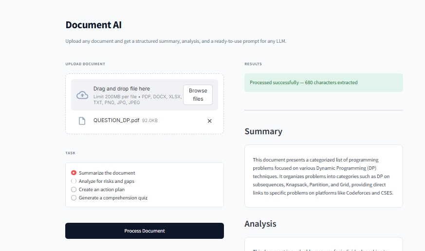

<div align="center">

# Document AI

**Turn any document into structured insights and ready-to-use LLM prompts.**

[](https://doc-intel-agent-koyfkc2m9qomngy22a2hde.streamlit.app)
[](https://python.org)
[](https://fastapi.tiangolo.com)
[](https://streamlit.io)

**[Try the Live Demo](https://doc-intel-agent-koyfkc2m9qomngy22a2hde.streamlit.app)** | **[Quick Start](#quick-start)** | **[Report a Bug](https://github.com/AKASHRAUT108/doc-intel-agent/issues)**

</div>

---

## Screenshot

<div align="center">
  
</div>

---

## The Problem

You upload a 20-page PDF to ChatGPT. You ask *"Summarize this."* You get a generic answer that misses half the details, or worse — the LLM runs out of context window and forgets the document entirely.

**Document AI fixes this.** It's a preprocessing layer that turns any document into the *perfect* LLM prompt for your specific goal.

---

## How It Works

1. **Reads Anything** — PDFs, Word docs, Excel sheets, images (PNG/JPG)
2. **Extracts Text** — Smart routing: `pypdf` for digital PDFs (5s), `EasyOCR` for scanned docs
3. **Understands** — Google Gemini 2.5 Flash analyzes the content
4. **Generates** — Creates a 2-sentence summary, deep analysis, key facts, and a **specialized prompt**

### 4 Prompt Modes

| Mode | What It Does | Use Case |
|---|---|---|
| **Summarize** | Quick recap | Skim a long report |
| **Analyze** | Find gaps & risks | Due diligence on contracts |
| **Action Plan** | Turn docs into checklists | Extract TODOs from notes |
| **Quiz** | Test your understanding | Study from textbooks |

---
---

## Architecture

Document AI is built as **7 microservices** with a simple synchronous endpoint for fast, reliable demos:

```text
+-----------------+        +------------------+        +---------------+
|   Streamlit UI  |------->|  FastAPI Gateway |------->|   Gemini LLM  |
|   (port 8501)   |        |    (port 8010)   |        |   (2.5 Flash) |
+-----------------+        +------------------+        +---------------+
                                    |
                                    v
                           +------------------+
                           |   Document       |
                           |   Extractor      |
                           |  (pypdf + OCR)   |
                           +------------------+